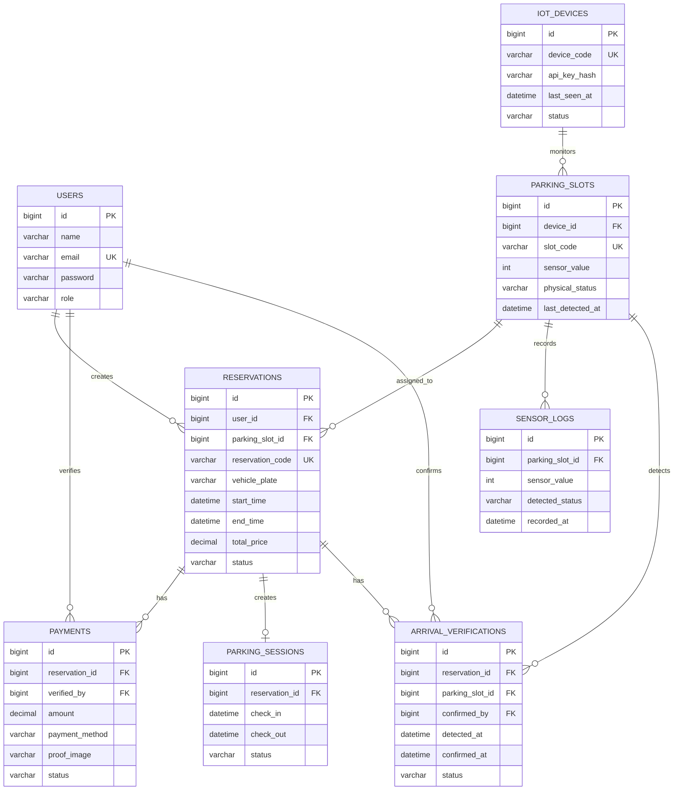
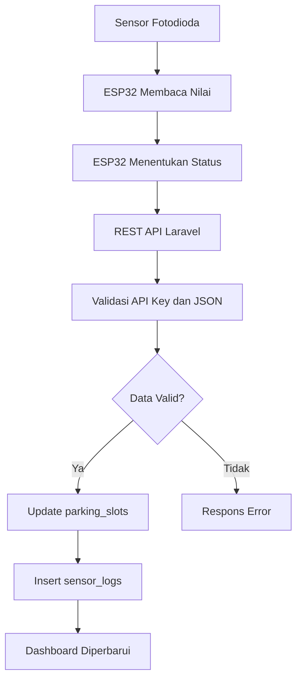
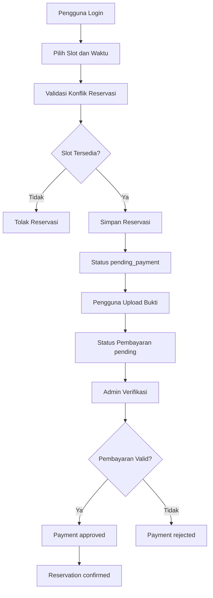
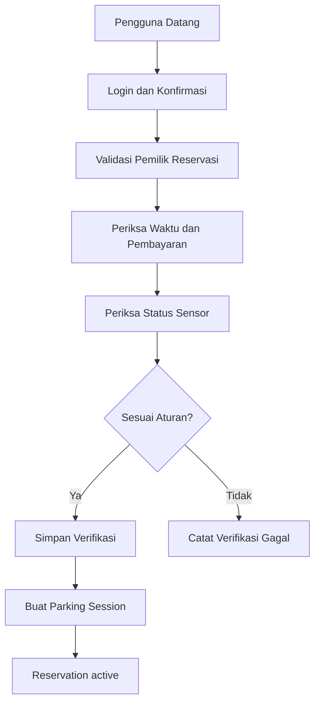

# DATABASE SCHEMA
# SMART PARKING SYSTEM

**Versi:** 1.0.0  
**Database:** MySQL 8.0.16+  
**Storage Engine:** InnoDB  
**Framework:** Laravel  
**Encoding:** utf8mb4  
**Timezone Penyimpanan:** UTC

---

## 1. Gambaran Umum Database

Database `smart_parking` digunakan untuk menyimpan data pengguna, perangkat IoT, slot parkir, reservasi, pembayaran, pembacaan sensor, sesi parkir, dan verifikasi kedatangan.

Sistem menggunakan delapan tabel inti:

| No. | Nama Tabel | Fungsi |
|---|---|---|
| 1 | users | Menyimpan data admin dan pengguna |
| 2 | iot_devices | Menyimpan identitas dan status perangkat ESP32 |
| 3 | parking_slots | Menyimpan data empat slot parkir |
| 4 | reservations | Menyimpan transaksi reservasi |
| 5 | payments | Menyimpan pembayaran dan verifikasi |
| 6 | sensor_logs | Menyimpan histori pembacaan sensor |
| 7 | parking_sessions | Menyimpan sesi check-in dan check-out |
| 8 | arrival_verifications | Menyimpan histori konfirmasi kedatangan |

### 1.1 Prinsip Perancangan

Database menggunakan prinsip berikut:

1. Setiap pengguna memiliki identitas unik.
2. Sistem memiliki dua role utama, yaitu `admin` dan `user`.
3. Setiap slot memiliki kode unik A01 sampai A04.
4. Satu slot dapat memiliki banyak reservasi pada waktu yang berbeda.
5. Satu reservasi dapat memiliki beberapa percobaan pembayaran.
6. Pembayaran yang disetujui harus memiliki identitas admin dan waktu verifikasi.
7. Data sensor disimpan terpisah dari data reservasi.
8. Setiap reservasi hanya boleh memiliki satu sesi parkir.
9. Histori verifikasi kedatangan dapat menyimpan beberapa percobaan.
10. Data transaksi tidak dihapus secara sembarangan karena diperlukan untuk laporan dan audit.

---

## 2. Relasi Antar Tabel

### 2.1 Entity Relationship Diagram



### 2.2 Penjelasan Relasi

- `users` ke `reservations`: satu pengguna dapat membuat banyak reservasi.
- `users` ke `payments`: satu admin dapat memverifikasi banyak pembayaran.
- `users` ke `arrival_verifications`: satu pengguna dapat melakukan beberapa percobaan konfirmasi.
- `iot_devices` ke `parking_slots`: satu ESP32 dapat memantau beberapa slot.
- `parking_slots` ke `reservations`: satu slot dapat memiliki banyak reservasi pada waktu berbeda.
- `parking_slots` ke `sensor_logs`: satu slot memiliki banyak histori pembacaan sensor.
- `reservations` ke `payments`: satu reservasi dapat memiliki beberapa percobaan pembayaran.
- `reservations` ke `parking_sessions`: satu reservasi maksimal memiliki satu sesi parkir.
- `reservations` ke `arrival_verifications`: satu reservasi dapat memiliki beberapa histori verifikasi.

---

## 3. Spesifikasi Tabel dan Kolom

## 3.1 Tabel `users`

Digunakan untuk menyimpan data administrator dan pengguna.

| Kolom | Tipe Data | Constraint | Keterangan |
|---|---|---|---|
| id | BIGINT UNSIGNED | PK, AI | ID pengguna |
| name | VARCHAR(100) | NOT NULL | Nama lengkap |
| email | VARCHAR(150) | UNIQUE, NOT NULL | Email login |
| phone | VARCHAR(20) | NULL | Nomor telepon |
| password | VARCHAR(255) | NOT NULL | Password hash |
| role | VARCHAR(20) | NOT NULL | admin atau user |
| is_active | BOOLEAN | DEFAULT TRUE | Status akun |
| email_verified_at | TIMESTAMP | NULL | Waktu verifikasi email |
| created_at | TIMESTAMP | NULL | Waktu pembuatan |
| updated_at | TIMESTAMP | NULL | Waktu perubahan |

**Aturan:**
- Email tidak boleh duplikat.
- Password wajib disimpan menggunakan hashing Laravel.
- Role hanya boleh `admin` atau `user`.
- Pengguna nonaktif tidak dapat melakukan transaksi baru.
- Jangan menyimpan password dalam bentuk teks biasa.

## 3.2 Tabel `iot_devices`

Menyimpan identitas perangkat ESP32 yang mengirim data sensor.

| Kolom | Tipe Data | Constraint | Keterangan |
|---|---|---|---|
| id | BIGINT UNSIGNED | PK, AI | ID perangkat |
| device_code | VARCHAR(50) | UNIQUE, NOT NULL | Identitas perangkat |
| device_name | VARCHAR(100) | NULL | Nama perangkat |
| api_key_hash | VARCHAR(255) | NOT NULL | Hash API key |
| status | VARCHAR(20) | DEFAULT 'offline' | online/offline |
| last_seen_at | DATETIME | NULL | Heartbeat terakhir |
| created_at | TIMESTAMP | NULL | Waktu pembuatan |
| updated_at | TIMESTAMP | NULL | Waktu perubahan |

**Aturan:**
- Setiap perangkat mempunyai `device_code` unik.
- API key mentah tidak disimpan dalam database.
- Backend memverifikasi API key terhadap hash yang tersimpan.
- Status online ditentukan berdasarkan heartbeat.
- Perangkat dapat dianggap offline jika tidak mengirim heartbeat melewati batas waktu yang ditentukan.

## 3.3 Tabel `parking_slots`

Menyimpan informasi empat slot parkir dan kondisi fisik berdasarkan sensor.

| Kolom | Tipe Data | Constraint | Keterangan |
|---|---|---|---|
| id | BIGINT UNSIGNED | PK, AI | ID slot |
| device_id | BIGINT UNSIGNED | FK, NULL | Perangkat pemantau |
| slot_code | VARCHAR(10) | UNIQUE, NOT NULL | A01–A04 |
| sensor_channel | VARCHAR(20) | NULL | Kanal sensor |
| sensor_value | INT | NULL | Nilai pembacaan sensor |
| physical_status | VARCHAR(20) | DEFAULT 'unknown' | empty/occupied/unknown |
| last_detected_at | DATETIME | NULL | Waktu deteksi terakhir |
| created_at | TIMESTAMP | NULL | Waktu pembuatan |
| updated_at | TIMESTAMP | NULL | Waktu perubahan |

**Aturan:**
- Hanya terdapat empat slot awal: A01, A02, A03, A04.
- `slot_code` harus unik.
- `physical_status` hanya boleh berisi `empty`, `occupied`, atau `unknown`.
- Nilai `unknown` digunakan saat sensor belum memberikan data valid atau perangkat tidak dapat dipercaya.
- `sensor_value` menyimpan nilai pembacaan mentah untuk keperluan monitoring dan kalibrasi.
- `sensor_channel` menunjukkan input sensor yang terhubung pada ESP32.

**Penting:** Status fisik slot bukan status ketersediaan reservasi.

Contoh:

| Slot | Status Fisik | Status Reservasi | Keterangan |
|---|---|---|---|
| A01 | empty | available | Dapat dipesan |
| A02 | empty | confirmed | Sudah dipesan untuk waktu tertentu |
| A03 | occupied | active | Sedang digunakan |
| A04 | unknown | unavailable | Sensor tidak dapat dipastikan |

Ketersediaan reservasi harus dihitung dari waktu reservasi, konflik jadwal, dan aturan operasional, bukan hanya dari sensor.

## 3.4 Tabel `reservations`

Menyimpan transaksi pemesanan slot parkir.

| Kolom | Tipe Data | Constraint | Keterangan |
|---|---|---|---|
| id | BIGINT UNSIGNED | PK, AI | ID reservasi |
| reservation_code | VARCHAR(50) | UNIQUE, NOT NULL | Kode reservasi |
| user_id | BIGINT UNSIGNED | FK, NOT NULL | Pemilik reservasi |
| parking_slot_id | BIGINT UNSIGNED | FK, NOT NULL | Slot yang dipesan |
| vehicle_plate | VARCHAR(20) | NOT NULL | Nomor polisi |
| start_time | DATETIME | NOT NULL | Waktu mulai |
| end_time | DATETIME | NOT NULL | Waktu selesai |
| total_price | DECIMAL(12,2) | NOT NULL | Total pembayaran |
| status | VARCHAR(30) | NOT NULL | Status reservasi |
| arrival_confirmed_at | DATETIME | NULL | Waktu konfirmasi kedatangan |
| cancelled_at | DATETIME | NULL | Waktu pembatalan |
| created_at | TIMESTAMP | NULL | Waktu pembuatan |
| updated_at | TIMESTAMP | NULL | Waktu perubahan |

**Status reservasi yang direkomendasikan:**

| Status | Penjelasan |
|---|---|
| pending_payment | Menunggu pembayaran |
| waiting_verification | Bukti pembayaran menunggu pemeriksaan |
| confirmed | Pembayaran telah disetujui |
| active | Kendaraan sedang menggunakan slot |
| completed | Sesi parkir selesai |
| rejected | Reservasi ditolak |
| cancelled | Reservasi dibatalkan |
| expired | Reservasi kedaluwarsa |

**Aturan:**
- `reservation_code` harus unik.
- `user_id` harus merujuk ke pengguna yang valid.
- `parking_slot_id` harus merujuk ke slot yang valid.
- `end_time` harus lebih besar daripada `start_time`.
- `total_price` tidak boleh negatif.
- Nomor polisi harus divalidasi dan dinormalisasi.
- Reservasi tidak boleh bertabrakan dengan reservasi lain yang masih aktif secara bisnis pada slot dan rentang waktu yang sama.

**Pemeriksaan konflik waktu:**

Dua reservasi dianggap bertabrakan apabila:

```sql
existing.start_time < new.end_time
AND existing.end_time > new.start_time
```

Pemeriksaan juga harus membatasi status reservasi yang masih memblokir slot, misalnya `pending_payment`, `waiting_verification`, `confirmed`, dan `active`, sesuai kebijakan kedaluwarsa dan pembatalan.

**Pencegahan double booking:**

Pemeriksaan konflik harus dilakukan di dalam transaksi database:

1. Mulai transaksi.
2. Kunci baris slot menggunakan `SELECT ... FOR UPDATE`.
3. Periksa reservasi lain yang waktunya bertabrakan.
4. Jika konflik ditemukan, batalkan transaksi.
5. Jika tidak ada konflik, buat reservasi.
6. Commit transaksi.

Jangan hanya mengandalkan validasi JavaScript atau pemeriksaan sebelum transaksi karena dua pengguna dapat memesan pada waktu bersamaan.

## 3.5 Tabel `payments`

Menyimpan informasi pembayaran dan hasil verifikasi admin.

| Kolom | Tipe Data | Constraint | Keterangan |
|---|---|---|---|
| id | BIGINT UNSIGNED | PK, AI | ID pembayaran |
| reservation_id | BIGINT UNSIGNED | FK, NOT NULL | Reservasi terkait |
| amount | DECIMAL(12,2) | NOT NULL | Nominal pembayaran |
| payment_method | VARCHAR(30) | NOT NULL | bank_transfer |
| proof_image | VARCHAR(255) | NULL | Lokasi file bukti |
| status | VARCHAR(20) | NOT NULL | Status pembayaran |
| verified_by | BIGINT UNSIGNED | FK, NULL | Admin pemeriksa |
| verified_at | DATETIME | NULL | Waktu verifikasi |
| rejection_reason | TEXT | NULL | Alasan penolakan |
| created_at | TIMESTAMP | NULL | Waktu pembuatan |
| updated_at | TIMESTAMP | NULL | Waktu perubahan |

**Status pembayaran:**

| Status | Penjelasan |
|---|---|
| unpaid | Belum ada pembayaran |
| pending | Bukti pembayaran telah dikirim |
| approved | Pembayaran disetujui |
| rejected | Pembayaran ditolak |

**Aturan:**
- Satu reservasi dapat mempunyai beberapa percobaan pembayaran.
- Setiap pembayaran hanya dapat diverifikasi oleh admin.
- `verified_by` wajib terisi ketika status menjadi `approved` atau `rejected`.
- `verified_at` wajib terisi ketika pembayaran sudah diverifikasi.
- Pembayaran yang telah disetujui tidak boleh diproses ulang tanpa prosedur koreksi yang tercatat.
- Maksimal satu pembayaran berstatus `approved` untuk satu reservasi.
- Bukti transfer disimpan pada storage privat, bukan direktori publik yang dapat diakses tanpa otorisasi.

**Perhitungan pendapatan:**

Pendapatan dihitung dari pembayaran berstatus `approved`, dikelompokkan berdasarkan tanggal `verified_at`, bukan tanggal reservasi dibuat.

## 3.6 Tabel `sensor_logs`

Menyimpan histori pembacaan sensor setiap slot.

| Kolom | Tipe Data | Constraint | Keterangan |
|---|---|---|---|
| id | BIGINT UNSIGNED | PK, AI | ID log |
| parking_slot_id | BIGINT UNSIGNED | FK, NOT NULL | Slot terkait |
| sensor_value | INT | NULL | Nilai sensor |
| detected_status | VARCHAR(20) | NOT NULL | empty/occupied/unknown |
| recorded_at | DATETIME | NOT NULL | Waktu pembacaan |
| created_at | TIMESTAMP | NULL | Waktu pencatatan |
| updated_at | TIMESTAMP | NULL | Waktu perubahan |

**Aturan:**
- Setiap log harus terhubung dengan slot.
- Histori digunakan untuk analisis perubahan status dan pengujian akurasi.
- Pencatatan dapat dilakukan ketika terjadi perubahan status atau melalui interval sampling tertentu.
- Hindari menyimpan data terlalu sering tanpa kebutuhan karena dapat memperbesar database.

## 3.7 Tabel `parking_sessions`

Menyimpan informasi penggunaan slot setelah pengguna melakukan konfirmasi kedatangan.

| Kolom | Tipe Data | Constraint | Keterangan |
|---|---|---|---|
| id | BIGINT UNSIGNED | PK, AI | ID sesi |
| reservation_id | BIGINT UNSIGNED | FK, UNIQUE | Reservasi terkait |
| check_in | DATETIME | NULL | Waktu masuk |
| check_out | DATETIME | NULL | Waktu keluar |
| status | VARCHAR(20) | NOT NULL | active/completed |
| created_at | TIMESTAMP | NULL | Waktu pembuatan |
| updated_at | TIMESTAMP | NULL | Waktu perubahan |

**Aturan:**
- Satu reservasi maksimal memiliki satu sesi parkir.
- `check_out` tidak boleh lebih awal daripada `check_in`.
- Sesi aktif harus memiliki `check_in`.
- Sesi selesai harus memiliki `check_out`.
- Check-in hanya dapat dilakukan jika reservasi memenuhi aturan kedatangan dan pembayaran.
- Check-out mengakhiri sesi parkir dan memperbarui status reservasi menjadi `completed`.

## 3.8 Tabel `arrival_verifications`

Menyimpan histori proses verifikasi kedatangan pengguna dan deteksi sensor.

| Kolom | Tipe Data | Constraint | Keterangan |
|---|---|---|---|
| id | BIGINT UNSIGNED | PK, AI | ID verifikasi |
| reservation_id | BIGINT UNSIGNED | FK, NOT NULL | Reservasi terkait |
| parking_slot_id | BIGINT UNSIGNED | FK, NOT NULL | Slot yang diperiksa |
| detected_at | DATETIME | NULL | Waktu deteksi sensor |
| confirmed_by | BIGINT UNSIGNED | FK, NULL | Pengguna yang konfirmasi |
| confirmed_at | DATETIME | NULL | Waktu konfirmasi |
| status | VARCHAR(20) | NOT NULL | Hasil verifikasi |
| notes | TEXT | NULL | Catatan verifikasi |
| created_at | TIMESTAMP | NULL | Waktu pembuatan |
| updated_at | TIMESTAMP | NULL | Waktu perubahan |

**Status verifikasi:**
- `pending`: belum selesai diverifikasi.
- `verified`: akun dan kondisi sistem memenuhi aturan konfirmasi.
- `failed`: konfirmasi gagal.
- `expired`: waktu konfirmasi telah kedaluwarsa.

**Aturan:**
- Reservasi harus terhubung dengan slot yang sama.
- Pengguna yang melakukan konfirmasi harus merupakan pemilik reservasi.
- Waktu konfirmasi harus sesuai rentang kedatangan yang diizinkan.
- Sensor harus memberikan status valid sesuai kebijakan sistem.
- Verifikasi yang berhasil dapat digunakan sebagai dasar pembuatan sesi parkir.
- Histori percobaan tetap disimpan untuk audit.

**Batasan:** Sensor fotodioda hanya mendeteksi perubahan intensitas cahaya atau kondisi objek di area sensor. Sensor tidak mengenali identitas kendaraan, nomor polisi, atau identitas pengemudi. Karena itu, `verified` berarti proses pencocokan akun, reservasi, waktu, dan deteksi sensor memenuhi aturan aplikasi, bukan bukti identitas kendaraan secara biometrik.

---

## 4. Index dan Unique Constraint

Index digunakan untuk mempercepat pencarian, join, dan proses transaksi.

| Tabel | Index / Constraint | Tujuan |
|---|---|---|
| users | UNIQUE(email) | Mencegah email duplikat |
| users | INDEX(role, is_active) | Filter pengguna berdasarkan role dan status |
| iot_devices | UNIQUE(device_code) | Identitas perangkat unik |
| parking_slots | UNIQUE(slot_code) | Kode slot unik |
| parking_slots | INDEX(device_id, sensor_channel) | Pencarian kanal perangkat |
| parking_slots | INDEX(physical_status) | Filter kondisi fisik |
| reservations | UNIQUE(reservation_code) | Kode reservasi unik |
| reservations | INDEX(user_id, created_at) | Riwayat reservasi pengguna |
| reservations | INDEX(parking_slot_id, start_time, end_time) | Pencarian konflik waktu |
| reservations | INDEX(status, start_time) | Filter reservasi |
| payments | INDEX(reservation_id, status) | Pencarian pembayaran reservasi |
| payments | INDEX(status, created_at) | Daftar verifikasi admin |
| payments | INDEX(verified_at, status) | Laporan pendapatan |
| payments | INDEX(verified_by) | Audit admin pemeriksa |
| sensor_logs | INDEX(parking_slot_id, recorded_at) | Histori sensor berdasarkan slot |
| parking_sessions | UNIQUE(reservation_id) | Satu sesi per reservasi |
| parking_sessions | INDEX(status, check_in) | Pencarian sesi aktif |
| arrival_verifications | INDEX(reservation_id, created_at) | Histori verifikasi reservasi |
| arrival_verifications | INDEX(parking_slot_id, detected_at) | Histori deteksi slot |
| arrival_verifications | INDEX(confirmed_by) | Audit pengguna yang mengonfirmasi |

**Catatan penting:** Index gabungan pada `reservations` membantu pencarian konflik, tetapi tidak otomatis menjamin tidak ada rentang waktu yang bertabrakan. Pencegahan tetap harus dilakukan menggunakan transaksi dan row locking.

---

## 5. Aturan Integritas Database

### 5.1 Primary Key
- Semua tabel menggunakan `BIGINT UNSIGNED AUTO_INCREMENT` sebagai primary key.
- ID menjadi identitas internal setiap record.

### 5.2 Foreign Key
Relasi foreign key harus menggunakan tipe data yang sama dengan primary key yang dirujuk.

Rekomendasi tindakan saat data induk dihapus:

| Relasi | Aturan |
|---|---|
| reservations.user_id | RESTRICT |
| reservations.parking_slot_id | RESTRICT |
| payments.reservation_id | RESTRICT |
| payments.verified_by | SET NULL |
| parking_slots.device_id | SET NULL |
| sensor_logs.parking_slot_id | RESTRICT |
| parking_sessions.reservation_id | RESTRICT |
| arrival_verifications.reservation_id | RESTRICT |
| arrival_verifications.parking_slot_id | RESTRICT |
| arrival_verifications.confirmed_by | SET NULL |

Untuk tabel transaksi dan histori, gunakan penghapusan terbatas agar catatan tidak hilang akibat penghapusan pengguna atau slot.

### 5.3 Validasi Nilai

Gunakan validasi pada Laravel dan, jika memungkinkan, CHECK constraint MySQL.

Contoh aturan:
- `end_time > start_time`.
- `total_price >= 0`.
- `amount >= 0`.
- `physical_status` hanya menerima nilai yang diizinkan.
- `role` hanya menerima `admin` dan `user`.
- `parking_sessions.check_out` tidak boleh lebih kecil dari `check_in`.
- `status` harus sesuai daftar status yang telah ditetapkan.

CHECK constraint untuk nilai dan waktu dapat ditambahkan melalui migration. Pastikan versi MySQL yang digunakan benar-benar menegakkan CHECK constraint.

### 5.4 Pengelolaan Waktu
- Simpan seluruh waktu transaksi dalam UTC.
- Konversi ke `Asia/Jakarta` saat menampilkan data kepada pengguna.
- Gunakan `DATETIME` secara konsisten untuk waktu reservasi dan histori.
- Tentukan aturan batas waktu reservasi, kedatangan, dan kedaluwarsa secara eksplisit.

---

## 6. Alur Penyimpanan Data

### 6.1 Alur Pembacaan Sensor



### 6.2 Alur Reservasi



### 6.3 Alur Kedatangan



---

## 7. Contoh Query SQL

### 7.1 Melihat Seluruh Slot

```sql
SELECT
    slot_code,
    sensor_value,
    physical_status,
    last_detected_at
FROM parking_slots
ORDER BY slot_code ASC;
```

### 7.2 Melihat Riwayat Reservasi Pengguna

```sql
SELECT
    r.reservation_code,
    r.vehicle_plate,
    p.slot_code,
    r.start_time,
    r.end_time,
    r.total_price,
    r.status
FROM reservations r
JOIN parking_slots p
    ON r.parking_slot_id = p.id
WHERE r.user_id = ?
ORDER BY r.created_at DESC;
```

### 7.3 Melihat Pembayaran Menunggu Verifikasi

```sql
SELECT
    payments.id,
    reservations.reservation_code,
    users.name,
    payments.amount,
    payments.proof_image,
    payments.status,
    payments.created_at
FROM payments
JOIN reservations
    ON payments.reservation_id = reservations.id
JOIN users
    ON reservations.user_id = users.id
WHERE payments.status = 'pending'
ORDER BY payments.created_at ASC;
```

### 7.4 Menghitung Pendapatan Harian

```sql
SELECT
    DATE(verified_at) AS tanggal,
    SUM(amount) AS total_pendapatan
FROM payments
WHERE status = 'approved'
  AND verified_at >= ?
  AND verified_at < ?
GROUP BY DATE(verified_at)
ORDER BY tanggal ASC;
```

Parameter waktu menggunakan batas awal dan batas akhir hari dalam UTC setelah dikonversi dari zona waktu laporan.

### 7.5 Melihat Histori Sensor

```sql
SELECT
    p.slot_code,
    s.sensor_value,
    s.detected_status,
    s.recorded_at
FROM sensor_logs s
JOIN parking_slots p
    ON s.parking_slot_id = p.id
WHERE p.slot_code = ?
ORDER BY s.recorded_at DESC
LIMIT 100;
```

---

## 8. Standar Keamanan dan Backup

### 8.1 Keamanan Database
- Gunakan password database yang kuat.
- Jangan menyimpan kredensial database dalam repository publik.
- Gunakan `.env` untuk konfigurasi koneksi.
- Gunakan Eloquent ORM atau parameter binding.
- Batasi akses database berdasarkan kebutuhan aplikasi.
- Jangan memberikan akses langsung MySQL kepada ESP32.
- Gunakan API key untuk komunikasi perangkat.
- Gunakan HTTPS saat aplikasi sudah online.
- Validasi semua input sebelum disimpan.

### 8.2 Keamanan File Pembayaran
- Simpan bukti pembayaran pada storage privat.
- Batasi ekstensi file yang diterima.
- Validasi MIME type dan ukuran file.
- Gunakan nama file acak.
- Jangan menggunakan nama file dari pengguna sebagai nama file penyimpanan.
- File hanya dapat dilihat melalui endpoint yang memeriksa otorisasi.

### 8.3 Backup
- Buat backup database secara berkala.
- Simpan backup di lokasi terpisah dari server utama.
- Uji proses pemulihan database.
- Simpan backup file bukti pembayaran.
- Tentukan masa retensi backup.

---

## 9. Implementasi Migration Laravel

Rekomendasi urutan pembuatan migration:

1. `create_users_table`
2. `create_iot_devices_table`
3. `create_parking_slots_table`
4. `create_reservations_table`
5. `create_payments_table`
6. `create_sensor_logs_table`
7. `create_parking_sessions_table`
8. `create_arrival_verifications_table`

Perintah pembuatan migration:

```bash
php artisan make:migration create_iot_devices_table
php artisan make:migration create_parking_slots_table
php artisan make:migration create_reservations_table
php artisan make:migration create_payments_table
php artisan make:migration create_sensor_logs_table
php artisan make:migration create_parking_sessions_table
php artisan make:migration create_arrival_verifications_table
```

Jalankan seluruh migration:

```bash
php artisan migrate
```

Untuk mengisi data awal:

```bash
php artisan db:seed
```

Untuk memeriksa status migration:

```bash
php artisan migrate:status
```

**Perhatian:** Tabel `users` dapat menggunakan migration bawaan Laravel yang disesuaikan. Jangan membuat migration kedua dengan nama atau tujuan yang bertabrakan.

---

## 10. Data Awal yang Harus Tersedia

### 10.1 Slot Parkir

| slot_code | physical_status |
|---|---|
| A01 | unknown |
| A02 | unknown |
| A03 | unknown |
| A04 | unknown |

### 10.2 Perangkat ESP32

| device_code | status |
|---|---|
| ESP32-PARKING-01 | offline |

Data awal perangkat belum berarti perangkat sudah terhubung. Status akan berubah berdasarkan heartbeat yang diterima backend.

### 10.3 Role Pengguna

| role | Hak Akses |
|---|---|
| admin | Mengelola sistem dan memverifikasi transaksi |
| user | Melakukan reservasi dan mengelola transaksi sendiri |

---

## 11. Ketentuan Final Database

Database dinyatakan siap digunakan ketika:

- [ ] Seluruh delapan tabel berhasil dibuat.
- [ ] Seluruh primary key dan foreign key berfungsi.
- [ ] Unique constraint dan index telah diterapkan.
- [ ] Data awal slot A01–A04 tersedia.
- [ ] Data perangkat ESP32 tersedia.
- [ ] Relasi pengguna dan reservasi berfungsi.
- [ ] Relasi reservasi dan pembayaran berfungsi.
- [ ] Histori sensor berhasil disimpan.
- [ ] Histori kedatangan berhasil disimpan.
- [ ] Sesi parkir berhasil dibuat dan diselesaikan.
- [ ] Konflik reservasi dapat dicegah.
- [ ] Pembayaran yang disetujui dapat dihitung dengan benar.
- [ ] Backup dan pemulihan database telah diuji.

**Catatan akhir:** Dokumen ini merupakan spesifikasi rancangan database. Implementasi migration harus mengikuti struktur, tipe data, relasi, index, dan aturan integritas yang dijelaskan di atas. Perubahan struktur setelah implementasi sebaiknya dilakukan melalui migration baru, bukan mengubah database production secara manual.